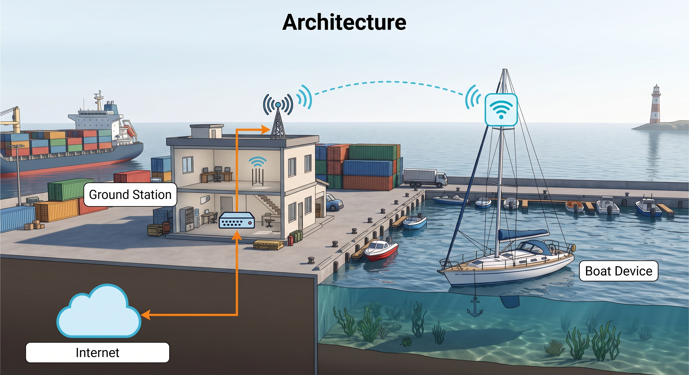
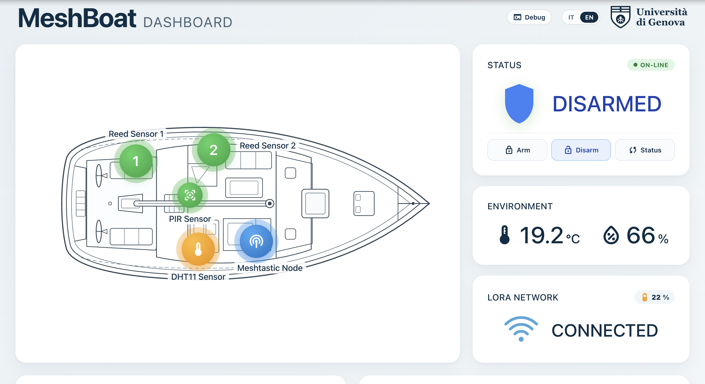
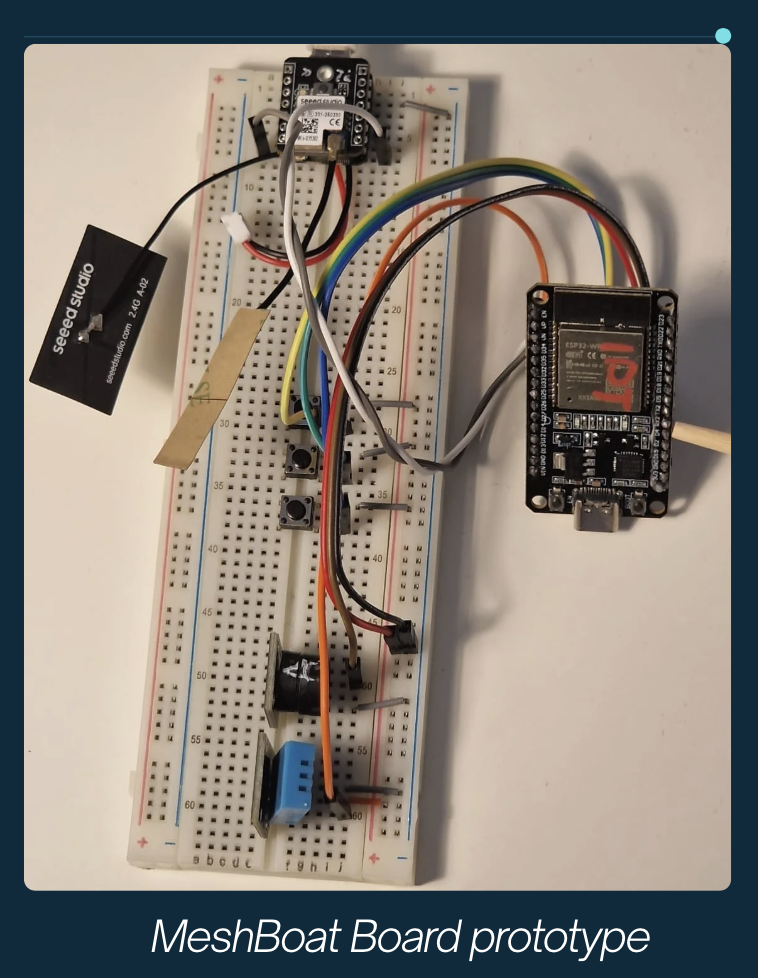
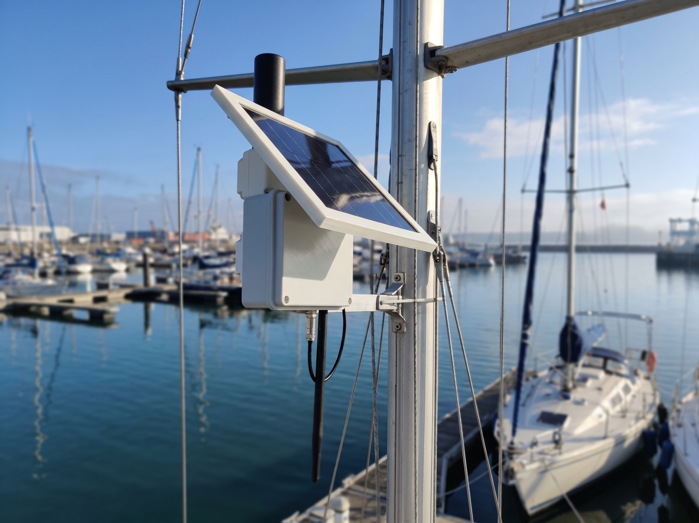
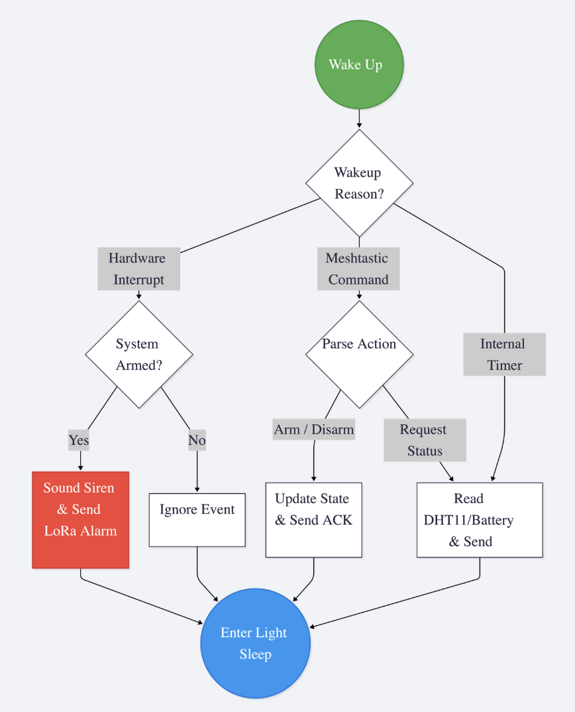
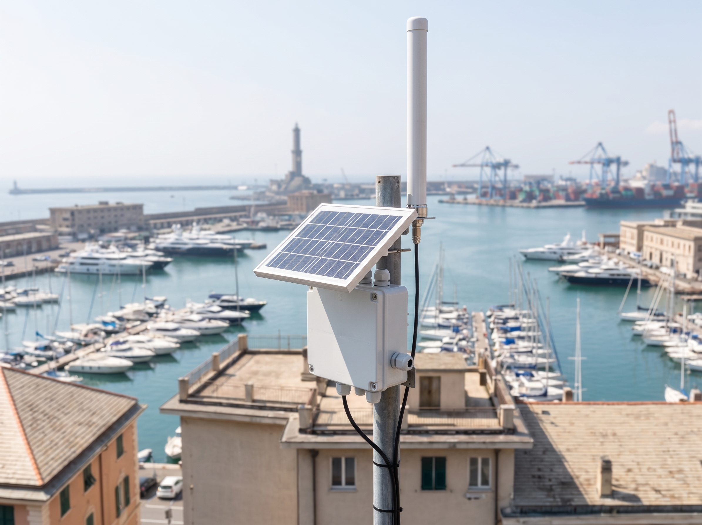

# MeshBoatGuard

> **Off-grid boat security and telemetry system powered by ESP32 and Meshtastic LoRa mesh networking.**

<p align="center">
  
</p>

<p align="center">
  
  
  <a href="docker-compose.yml"></a>
  
</p>

---

## The Problem & The Idea

When you leave a boat moored in a harbor or at an anchor buoy, protecting it is tricky. Wi-Fi does not reach the dock, and cellular signal on the water is often weak. Existing boat alarms are expensive, require paid SIM cards, and drain the boat's battery.

Our goal was simple: use the **Meshtastic** mesh network to protect a moored boat without relying on cellular data or monthly fees.

- **Zero monthly fees:** Messages travel across free, decentralized LoRa radio (868 MHz).
- **Ultra-low power:** The boat node stays in sleep mode and wakes up only when a sensor triggers or a remote command arrives.
- **Harbor coverage:** A ground station at the port collects packets from the bay and forwards them to a self-hosted server.
- **Two-way control:** Owners can check battery and climate telemetry, or arm and disarm the alarm from anywhere using **Telegram** or the dedicated **Web Dashboard**.

---

## System Architecture

<p align="center">
  
</p>

The system is split into two physical parts:

1. **Boat Unit (Battery & Solar Powered):**
   - An **ESP32** monitors magnetic door/hatch sensors, a cabin motion sensor, and temperature/humidity.
   - It connects over serial (UART) to a **Seeed Studio XIAO ESP32S3** running Meshtastic firmware.
   - When an intrusion occurs, the ESP32 builds an ultra-compact JSON packet and sends it to the Meshtastic radio.
2. **Ground Station Gateway:**
   - A rooftop Meshtastic node picks up the LoRa signal and forwards packets over the local network via MQTT.
   - A **Docker** stack parses incoming data, logs metrics to **InfluxDB**, renders dashboards in **Grafana** and our custom **Web Dashboard**, and sends instant push notifications to **Telegram**.

---

## Interactive Real-Time Web Dashboard

In addition to Grafana and Telegram, MeshBoatGuard includes a custom, responsive, and lightweight **Web Dashboard** served directly on the local network without login gates or external cloud dependencies.

<p align="center">
  
</p>
<p align="center">
  <em>MeshBoat Live Dashboard – Technical boat blueprint with interactive sensor nodes, security status, climate metrics, and historical logs.</em>
</p>

### Key Dashboard Features:
- **Responsive Layout (Desktop, Smart TV & Mobile):** Seamlessly adapts across all screen sizes. On smartphones, the boat blueprint automatically rotates vertically for one-handed inspection.
- **Interactive Technical Blueprint:** Visual representation of the vessel with real-time sensor nodes:
  - **Reed 1 (Cabin Door)** & **Reed 2 (Bow Hatch)**
  - **PIR Motion Sensor**
  - **DHT11 Environmental Sensor** (Temperature & Humidity)
  - **Meshtastic LoRa Node**
- **Latching Alarm System:** When a security breach is detected, the affected zones turn bright red with an alert glow and remain locked in an alarm state until an explicit **Disarm** command is issued.
- **Direct Interactive Controls:** One-click remote action buttons (**Arm**, **Disarm**, **Status**) that transmit commands to the boat over LoRa via MQTT downlink.
- **Climate Telemetry Chart:** High-definition dual-line historical graph (Temperature °C & Humidity %) rendered on HTML5 canvas with 1h / 6h / 24h ranges.
- **Event & Intrusion Log:** Real-time table displaying the last 50 received packets with sensor source, armed state, and battery telemetry.
- **Bilingual Interface:** Instant language switch between **Italian (IT)** and **English (EN)**.
- **Collapsible Debug Terminal:** Inspect raw JSON payload envelopes received in real time.

---

## Hardware & Prototype

The boat unit uses two microcontrollers working together: the **ESP32** handles sensor reading and sleep logic, while the **Seeed Studio XIAO ESP32S3** manages the LoRa mesh network.

<p align="center">
  
  &nbsp;&nbsp;&nbsp;&nbsp;
  
</p>
<p align="center">
  <em>Left: Lab breadboard testing sensor interrupts and UART. Right: Mast-mounted outdoor enclosure with solar panel.</em>
</p>

### Wiring Table

| Component / Sensor | Function | ESP32 Pin | Meshtastic Pin (XIAO S3) | Details / Wakeup Type |
| :--- | :--- | :--- | :--- | :--- |
| **Reed Switch 1 (Bow)** | Digital In (Pull-down) | **GPIO 4** | — | Bow hatch opening (`EXT1_WAKEUP`) |
| **Reed Switch 2 (Cabin)** | Digital In (Pull-down) | **GPIO 13** | — | Cabin door opening (`EXT1_WAKEUP`) |
| **PIR Sensor** | Digital In (Pull-down) | **GPIO 14** | — | Cabin motion detection (`EXT1_WAKEUP`) |
| **Meshtastic TX** | UART2 RX | **GPIO 32** *(RTC)* | **D6 / TX** (GPIO 43) | **Remote Wakeup** (`EXT0_WAKEUP`) |
| **Meshtastic RX** | UART2 TX | **GPIO 33** *(RTC)* | **D7 / RX** (GPIO 44) | Sends JSON strings to radio |
| **DHT11** | 1-Wire Data | **GPIO 27** | — | Cabin temperature & humidity |
| **Buzzer / Warning LED**| Digital Out | **GPIO 15** | — | Local sound and light deterrence |

### How the Remote Wakeup Works
Deep sleep usually shuts down UART communication. To work around this without burning battery:
1. We put the ESP32 into **Light Sleep** (`esp_light_sleep_start()`).
2. We assign the serial RX line to **GPIO 32**, which belongs to the RTC power domain.
3. When the ground station sends a command over LoRa, the Meshtastic radio transmits a serial packet.
4. The start bit pulls the line `LOW`. This instantly wakes the ESP32 through `EXT0_WAKEUP` to process the command.

---

## Firmware & Communication Protocol

The firmware lives in [`MeshBoatGuard.ino`](MeshBoatGuard.ino).

<p align="center">
  
</p>
<p align="center">
  <em>Firmware workflow and state transitions.</em>
</p>

### Why Short JSON?
LoRa transmission time (airtime) must stay short to save battery and respect European duty-cycle limits (868 MHz). We keep all JSON messages under **65 bytes** by using single-character keys.

### Message Fields
| Key | Name | Example Value | Description |
| :--- | :--- | :--- | :--- |
| `t` | Type | `"ALM"`, `"TEL"`, `"ACK"`, `"CFG"` | Alarm, Telemetry, Acknowledgment, or Config |
| `dev` | Device ID | `"BoatGuard_01"` | Unique identifier of the boat |
| `s` | Status | `"ARM"`, `"DIS"` | Armed or Disarmed state |
| `src` | Source | `"PRUA"`, `"CABINA"`, `"PIR"`, `"CMD"` | Trigger cause |
| `tmp` | Temperature | `24.5` | Cabin temperature in °C |
| `hum` | Humidity | `58` | Relative humidity in % |
| `bat` | Battery | `98` | Battery charge percentage |

### Examples

**Alarm Packet (Boat &rarr; Ground Station):**
```json
{"t":"ALM","dev":"BoatGuard_01","s":"ARM","src":"PRUA","tmp":24.5,"hum":58,"bat":98}
```

**Remote Command (Telegram / Dashboard &rarr; Boat):**
```json
{"cmd":"ARM","val":1}
```

---

## Ground Station & Cloud Stack

<p align="center">
  
</p>

The backend runs in Docker containers on a ground server, Raspberry Pi, or laptop:

- **Mosquitto MQTT:** Ingests raw Meshtastic packets over Wi-Fi / LAN (`port 1884` with auth) and provides container communication (`port 1883`).
- **Node-RED:** Extracts JSON payloads, manages Telegram push alerts, routes commands, and proxies Web Dashboard interactions.
- **InfluxDB v2:** Stores time-series data (battery levels, temperature, alarm logs).
- **Grafana:** Displays analytics dashboards (`http://localhost:3000`).
- **Web Dashboard:** Dedicated responsive web app served by Nginx (`http://localhost:8090`).

### Quick Start

Make sure Docker and Docker Compose are installed, then run:

```bash
docker compose up -d
```

### Default Service Endpoints

| Service | Port | URL | Access / Credentials |
| :--- | :--- | :--- | :--- |
| **MeshBoat Dashboard** | `8090` | `http://localhost:8090` | Open access (no login required) |
| **Node-RED** | `1880` | `http://localhost:1880` | Open interface |
| **Grafana** | `3000` | `http://localhost:3000` | User: `admin` \| Pass: `admin` |
| **InfluxDB v2** | `8086` | `http://localhost:8086` | User: `admin` \| Pass: `meshboatguard123` |
| **Mosquitto MQTT** | `1884` | — | User: `meshboat` \| Pass: `meshboat` |

For detailed hardware setup, channel configurations, and MQTT integration:
- [Meshtastic Nodes Setup Guide](nodes_config.md)
- [Server & Backend Documentation](server/README_SERVER.md)
- [Meshtastic MQTT Integration Log](docs/MQTT_MESHTASTIC.md)

---

## Project Structure

```text
MeshBoatGuard/
├── MeshBoatGuard.ino          # ESP32 firmware (Light Sleep, sensor interrupts, UART)
├── docker-compose.yml         # Docker stack (Mosquitto, Node-RED, InfluxDB, Grafana, Dashboard)
├── nodes_config.md            # Step-by-step Meshtastic hardware & channel configuration guide
├── requirements.txt           # Python dependencies
├── docs/
│   └── MQTT_MESHTASTIC.md     # Setup and troubleshooting log for Meshtastic MQTT gateway
├── imgs/
│   ├── man-flag.jpeg          # Project hero banner
│   ├── architecture.jpeg      # End-to-end network architecture diagram
│   ├── dashboard.png          # Web dashboard preview
│   ├── prototype.png          # Lab breadboard prototype
│   ├── BoatDevice.jpeg        # Mast-mounted outdoor enclosure
│   ├── GroundStation.jpeg     # Rooftop ground station node
│   └── firmware.png           # Firmware state machine flowchart
└── server/
    ├── README_SERVER.md       # Full backend documentation
    ├── dashboard/             # Custom responsive web dashboard (Nginx, HTML5, CSS3, JS)
    │   ├── nginx.conf         # Reverse proxy configuration
    │   └── public/            # Frontend assets (index.html, style.css, app.js)
    ├── mosquitto/             # MQTT configuration and credentials
    ├── nodered/               # Node-RED flows and Telegram bot logic
    └── grafana/               # Grafana dashboard provisioning
```

---

## Authors & Academic Context

Developed in **2026** as the final project for the **Internet of Things (IoT)** course at the **University of Genoa (UniGe)**:

- **Mattia Coriale** (5640317)
- **Gabriele Alessandria** (5622102)
- **Federico Rissolio** (5241314)
